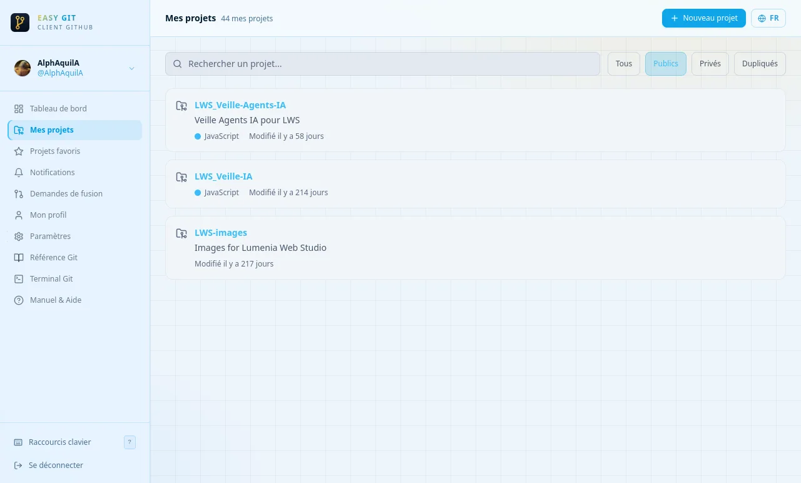
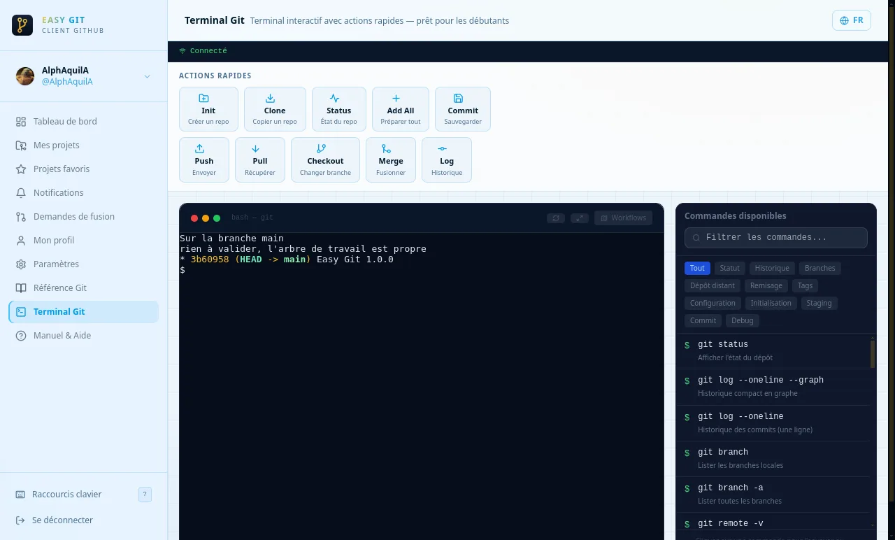
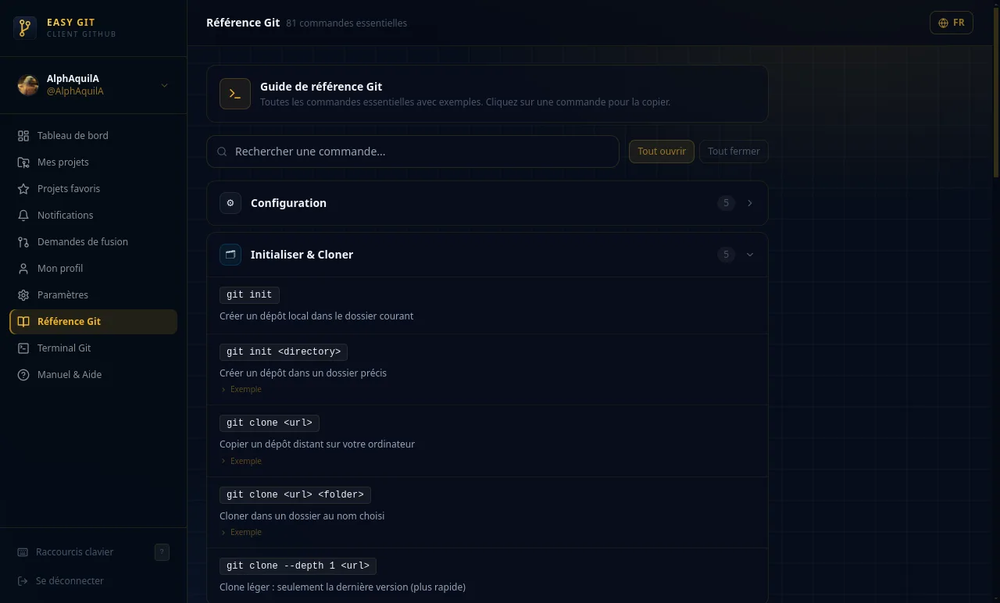
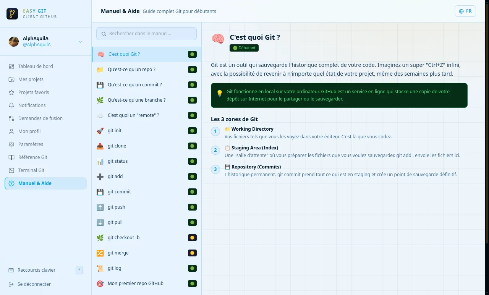

<p align="center">
  
</p>

<h1 align="center">Easy Git</h1>

<p align="center">
  Un client GitHub visuel, avec un vrai terminal intégré, pensé pour les débutants.<br>
  <em>A visual GitHub client with a real built-in terminal, made for beginners.</em>
</p>

<p align="center">
  <a href="https://easy-git.lumeniawebstudio.com"><strong>easy-git.lumeniawebstudio.com</strong></a><br>
  <a href="LICENSE">MIT</a> · Linux (.deb, AppImage) · Français
</p>

<p align="center">
  
</p>

<table>
  <tr>
    <td></td>
    <td></td>
    <td></td>
  </tr>
  <tr>
    <td align="center"><sub>Un vrai terminal, avec actions rapides</sub></td>
    <td align="center"><sub>81 commandes Git expliquées</sub></td>
    <td align="center"><sub>Un manuel pour débuter</sub></td>
  </tr>
</table>

---

**[Français](#français) · [English](#english)**

## Français

### Ce que fait Easy Git

- **Vos projets GitHub en un coup d'œil** : dépôts, favoris, notifications, demandes de fusion, issues, versions, profil.
- **Un vrai terminal Git** (xterm.js) avec des **actions rapides** (init, clone, status, commit, push, pull, merge…) : un clic remplit la commande, vous voyez ce qui s'exécute.
- **Des sorties expliquées** : les messages de Git (conflits, branche en retard…) sont traduits en langage clair, et une barre d'état affiche la branche et les fichiers modifiés.
- **Une référence Git** consultable et un **manuel** intégré.
- **Connexion en un clic** avec votre compte GitHub (pas de mot de passe à saisir dans l'application), ou par token personnel.
- Interface **en français**, thèmes clair et sombre. Traduction anglaise partielle, complète en v1.1.

### Installation (Linux)

Téléchargez le fichier qui vous convient depuis la page **[Releases](https://github.com/lumenia-webstudio/easy-git/releases)**.

**Option 1 — Installer l'application** (Ubuntu, Debian, Linux Mint) : fichier `.deb`

```bash
cd ~/Téléchargements
sudo apt install ./easy-git_1.0.0_amd64.deb
```

Easy Git apparaît ensuite dans le menu Applications (catégorie Développement) et se lance aussi avec la commande `easy-git`. Git est installé automatiquement s'il manque.

Pour désinstaller : `sudo apt remove easy-git`

**Option 2 — Sans installation** (toutes distributions) : fichier `.AppImage`

```bash
chmod +x "Easy-Git-1.0.0.AppImage"
./"Easy-Git-1.0.0.AppImage"
```

Ou : clic droit sur le fichier → Propriétés → *Autoriser l'exécution*, puis double-clic.

> Sur Ubuntu 22.04 et suivantes, si l'AppImage ne démarre pas : `sudo apt install libfuse2`.

**Vérifier le téléchargement** (facultatif) : `sha256sum` sur le fichier doit afficher la même empreinte que `SHA256SUMS.txt`, publié avec chaque version.

### Première connexion

Cliquez sur **« Se connecter avec GitHub »** : Easy Git affiche un code et ouvre `github.com/login/device` dans votre navigateur. Collez le code, autorisez, c'est fini.

### Sécurité et vie privée

- Votre jeton GitHub reste **sur votre ordinateur**. Easy Git ne parle qu'à GitHub, sans serveur intermédiaire.
- ⚠️ **Le terminal intégré est un vrai shell**, avec les droits de votre compte. La liste de commandes proposée guide les débutants, ce n'est pas une barrière de sécurité : ce que vous y tapez s'exécute réellement.
- Le serveur local qui alimente le terminal n'écoute que sur `127.0.0.1` et exige un jeton de session renouvelé à chaque lancement.

## English

### What Easy Git does

- **Your GitHub projects at a glance**: repositories, stars, notifications, pull requests, issues, releases, profile.
- **A real Git terminal** (xterm.js) with **quick actions** (init, clone, status, commit, push, pull, merge…): one click fills in the command, you see what runs.
- **Explained output**: Git messages (conflicts, branch behind…) translated into plain language, with a status bar showing the branch and changed files.
- A searchable **Git reference** and a built-in **manual**.
- **One-click sign-in** with your GitHub account (no password typed into the app), or with a personal access token.
- **French** interface, light and dark themes. The English translation is partial and will be completed in v1.1.

### Install (Linux)

Download from the **[Releases](https://github.com/lumenia-webstudio/easy-git/releases)** page.

- **Install it** (Ubuntu, Debian, Linux Mint): `sudo apt install ./easy-git_1.0.0_amd64.deb`. Easy Git then shows up in your applications menu and as the `easy-git` command. Uninstall with `sudo apt remove easy-git`.
- **No install** (any distribution): `chmod +x "Easy-Git-1.0.0.AppImage"`, then run it. On Ubuntu 22.04+, you may need `sudo apt install libfuse2`.

### Security and privacy

- Your GitHub token **stays on your computer**. Easy Git talks to GitHub only, with no server in between.
- ⚠️ **The built-in terminal is a real shell** running with your user's rights. The suggested command list guides beginners; it is not a security boundary.
- The local server behind the terminal listens on `127.0.0.1` only and requires a session token renewed at every launch.

## Développement · Development

Requires Node.js 22 and [pnpm](https://pnpm.io).

```bash
pnpm install
pnpm run electron:dev     # desktop app with hot reload
pnpm run dev              # web UI + local server only
pnpm run lint && pnpm run typecheck
pnpm run electron:build   # builds the AppImage into dist-electron-build/
```

Stack: React 18 · TypeScript · Vite · Tailwind CSS · Electron · Express · node-pty · xterm.js.

## Crédits · Credits

Une création de **[Lumenia Web Studio](https://lumeniawebstudio.com)**.
Made by **[Lumenia Web Studio](https://lumeniawebstudio.com)** — released under the [MIT License](LICENSE).
